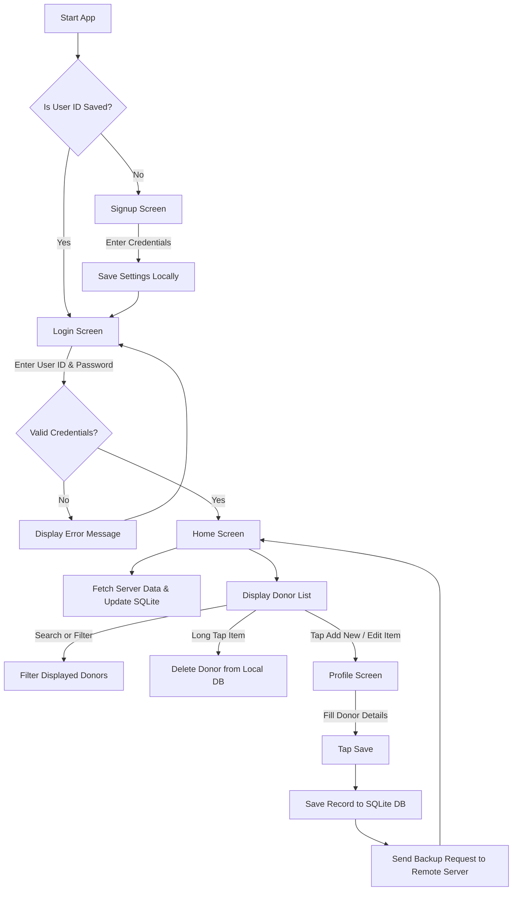
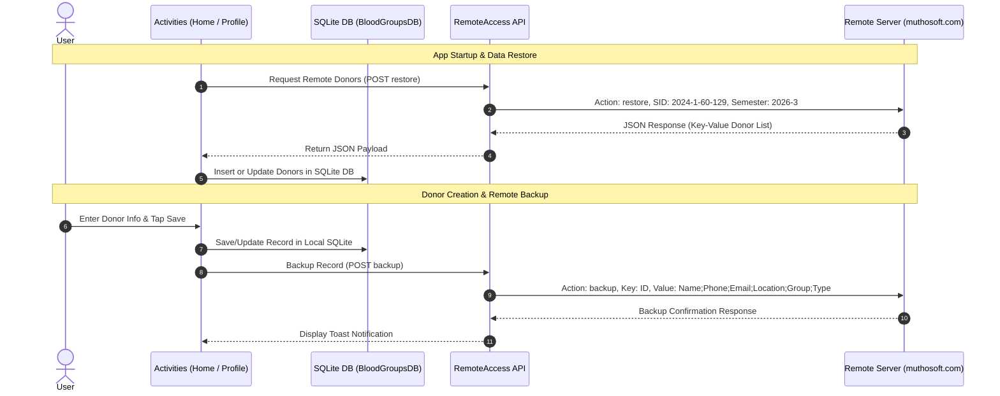

# Blood Donation Android Application

An Android application for managing blood donor records with local SQLite database storage and remote server synchronization.

---

## 🏗️ App Structure & Architecture

```text
BloodDonationApp/
├── app/
│   ├── src/
│   │   ├── main/
│   │   │   ├── java/edu/ewubd/cse489202631/
│   │   │   │   ├── BloodGroupsDB.java       # SQLite OpenHelper database manager
│   │   │   │   ├── CustomListAdapter.java    # Custom ArrayAdapter for donor list items
│   │   │   │   ├── Donor.java               # Model class for donor data
│   │   │   │   ├── HomeActivity.java        # Main dashboard (list, search, filter, sync)
│   │   │   │   ├── LoginActivity.java       # Login screen & authentication validation
│   │   │   │   ├── MainActivity.java        # Entry activity
│   │   │   │   ├── ProfileActivity.java     # Add/Edit donor profile screen
│   │   │   │   ├── RemoteAccess.java        # HTTP client for remote server API
│   │   │   │   └── SignupActivity.java      # Signup & initial launch activity
│   │   │   ├── res/
│   │   │   │   ├── layout/                  # XML UI layout definitions
│   │   │   │   │   ├── activity_home.xml
│   │   │   │   │   ├── activity_login.xml
│   │   │   │   │   ├── activity_main.xml
│   │   │   │   │   ├── activity_profile.xml
│   │   │   │   │   ├── activity_signup.xml
│   │   │   │   │   └── row_bg.xml
│   │   │   │   ├── drawable/                # Custom UI buttons and icon assets
│   │   │   │   ├── mipmap-anydpi-v26/       # Qualified launcher icons (API 26+)
│   │   │   │   └── values/                  # Strings, colors, and application themes
│   │   │   └── AndroidManifest.xml          # Manifest declaring components & permissions
│   └── build.gradle                         # Module-level Gradle configuration
├── build.gradle                             # Top-level build configuration
├── settings.gradle                          # Plugin & project settings
└── local.properties                         # Local SDK path properties
```

---

## 📊 Flowchart & System Interaction

GitHub renders the following Mermaid diagrams interactively.

### 1. User Application Flow



---

### 2. Architecture & Remote Data Sync Flow



---

## 📝 Compact Flowchart Description (ASD-STE100)

The following text uses **Simplified Technical English (ASD-STE100)** rules for clarity and simplicity.

### 1. App Startup and Account Check
- The app starts at the **Signup Screen**.
- The app checks local settings for a saved **User ID**.
- If a User ID exists, the app opens the **Login Screen**.
- If no User ID exists, the user enters user details to sign up.
- The app saves the user settings locally and opens the **Login Screen**.

### 2. User Authentication
- On the **Login Screen**, the user enters the **User ID** and **Password**.
- If the credentials are correct, the app opens the **Home Screen**.
- If the credentials are not correct, the app displays an error message.

### 3. Home Screen Operations
- On the **Home Screen**, the app fetches donor data from the remote server (`muthosoft.com`) and updates the local SQLite database.
- The app displays the list of blood donors stored in the local database.
- Users can search for donors by name, location, or blood group.
- Users can filter the list by selecting a blood group button.
- A long tap on a donor item shows a dialog to delete that donor from the local database.

### 4. Adding and Updating Donor Profiles
- Tapping **Add New** or tapping an existing donor opens the **Profile Screen**.
- On the **Profile Screen**, the user enters or edits the donor details (Name, Phone, Email, Location, Blood Group, Availability).
- When the user taps **Save**, the app saves the donor information into the local SQLite database and sends a backup copy to the remote server.
- The app then returns to the **Home Screen** and refreshes the list.

---

## 🗄️ Database Schema & Server API

### Local SQLite Database (`BloodGroupsDB.db`)
- **Table Name**: `blood_groups`
- **Columns**:
  - `ID` (`TEXT PRIMARY KEY`)
  - `name` (`TEXT`)
  - `phone` (`TEXT`)
  - `email` (`TEXT`)
  - `location` (`TEXT`)
  - `grp` (`TEXT`)
  - `type` (`INT` - 1 for Emergency, 0 for Regular)

### Remote REST Endpoints (`muthosoft.com`)
- **Restore Endpoint**: `https://www.muthosoft.com/univ/cse489/index.php`
- **Backup Endpoint**: `https://www.muthosoft.com/univ/cse489/key_value.php`
